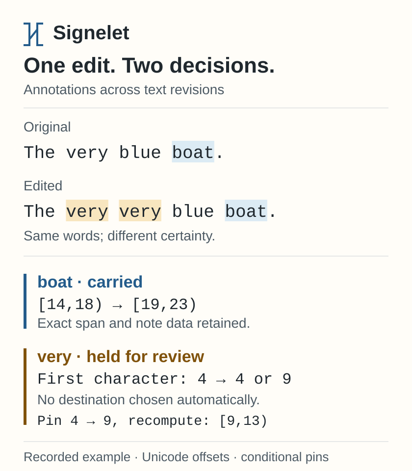

# Follow two notes through one edit

This is an executed, self-authored native STAM example, not a proposed interface.
The original is `The very blue boat.`; the edit is `The very very blue boat.`.
Both notes remain in the original store. Signelet creates a new edited-text note
only for a span whose characters have one agreed, consecutive, unchanged target.



## First, keep the disagreement

From the complete source checkout, after the [documented installation](../README.md#install), choose fresh output paths:

```sh
signelet session start examples/repeated.stam.json --source original --target edited --note very --note boat --directory review-two-notes
signelet session status review-two-notes
```

The start and status commands return **1**, a valid saved result needing review:

- `boat`: original `[14,18)` becomes edited `[19,23)`, selecting exactly `boat`.
- `very`: original `[4,8)` remains `review`. Its first source character at offset
  `4` has target candidates `4` and `9`. These are character hints, not a claim
  that arbitrary endpoint combinations form a valid span.

These are zero-based Unicode code-point positions with an excluded end. They are
not UTF-16 offsets or grapheme counts. No normalization is performed.

## Make the assumption visible

Copy the exact `revision` printed by `status` into the following command.
Do not type `CURRENT_REVISION` literally:

```sh
signelet session step review-two-notes --revision CURRENT_REVISION --note very --source-offset 4 --target-offset 9
signelet session snapshot review-two-notes --output two-notes-session.json
signelet session resume two-notes-session.json --directory reopened-two-notes
signelet session export reopened-two-notes --output two-notes-native.zip
signelet session replay two-notes-native.zip --directory replayed-two-notes
```

These operations returned **0** in the recorded run. The native export was
reopened with STAM: `very` selected edited `[9,13)` and `boat` selected
edited `[19,23)`. Both retained their original `notes/body` data values.
The replayed session journal was byte-for-byte equal to the accepted session.
Generated native annotation IDs may differ between computations; replay compares
their structure and references under the implementation's documented rules.

The pin **4 → 9 is a supplied assumption**. The second transfer is certain only
under that assumption and Signelet's fixed edit model. A saved journal is unsigned;
export and replay do not authenticate a reviewer or establish semantic truth.
An unresolved session can also be exported; its status stays unresolved.

## Inspect the evidence

- [Exact recorded texts, indices, outcomes and reopened note data](examples/repeated-transfer.json).
- [Original native STAM fixture](../examples/repeated.stam.json).
- [Agreement kernel](../src/signelet/_alignment.py), [native transposition adapter](../src/signelet/adapter.py), and [saved-session replay](../src/signelet/session.py).
- [Editable figure generator](assets/build-annotation-transfer.py), [SVG](assets/annotation-transfer.svg), [standalone HTML](assets/annotation-transfer.html), and [PNG](assets/annotation-transfer.png).

Executed on macOS arm64 with Python 3.12.13, STAM 0.12.1 and source
`a219bce84a570946add8d4e3236e26d8ed2ad2df`. The figure is a typographic view of
those recorded results, not a product screenshot or a new alignment algorithm.
Its generator checks the recorded spans before drawing and uses portable local
font stacks. The PNG is an actual Chrome rendering of the same SVG.

This one small fixture does not establish corpus-scale performance, user demand
or agreement with human interpretation. Budget exhaustion stays `unknown`;
unsupported selectors remain intact. See the [full model and limits](../README.md#what-agreement-means),
[bundle compatibility](../README.md#bundle-and-session-compatibility), and
[STAM lineage and licensing](../LICENSE). Keep private texts and note data private.
