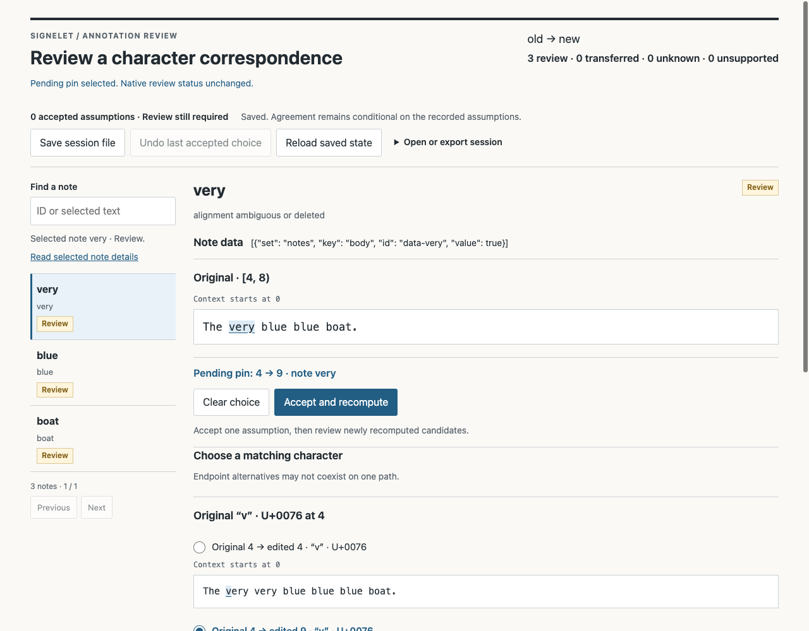

# Local session review capture

Captured from the actual local browser interface on November 16, 2026, at a 1280 × 1000 viewport. The screenshot is an unedited browser capture. SHA-256: `03e681e731fcd0b20cad8d1f217705fd3a6f6015b44877fa970e4ba0f71768d3`.

The bundled `examples/session-review.stam.json` supplies three self-authored notes (`very`, `blue`, `boat`) on invented text. No private annotation store or user profile was used. The original reads `The very blue blue boat.`; the edited text adds another occurrence of each repeated word. Native STAM preserves boolean and integer note data, including `9007199254740993`.

The capture shows a selected but **unaccepted** character assumption, original offset 4 to edited offset 9. All three notes still require review. Accepting it recomputes every selected note from the unchanged original store; a subsequent blue character choice at 9 to 19 completes these three notes. This is conditional agreement under the edit model and recorded assumptions, not semantic correctness or authenticated approval.

Current validation used Python 3.12.13, STAM 0.12.1 and Chrome 157 on macOS arm64. The 34 Python and 19 Node tests pass. Actual browser checks cover sequential choices, changing the viewed note while a different note owns the pending choice, save/undo/reopen, malformed-file recovery, and reopening a saved journal from the earlier interface. The browser's downloaded six-member ZIP independently replays through the native CLI, preserving exact original notes, resources, data types and destination offsets.

The pending and resumed interfaces fit 320, 390 and 1280 pixel widths. Six WCAG A/AA scans report no confirmed violations and no incomplete checks. This is bounded automated accessibility evidence; screen-reader testing remains separate. The exact generating interface is required to replay a native bundle. A matching saved journal can explicitly generate a new bundle; earlier bundles are retained unchanged.

The screenshot's runtime assets match the published source. It was captured from a temporary installed wheel; packaging and README edits made afterward do not change those assets. No new STAM acquisition, account or external service was used for this validation. Earlier feasibility evidence is retained in [validation.md](validation.md).
